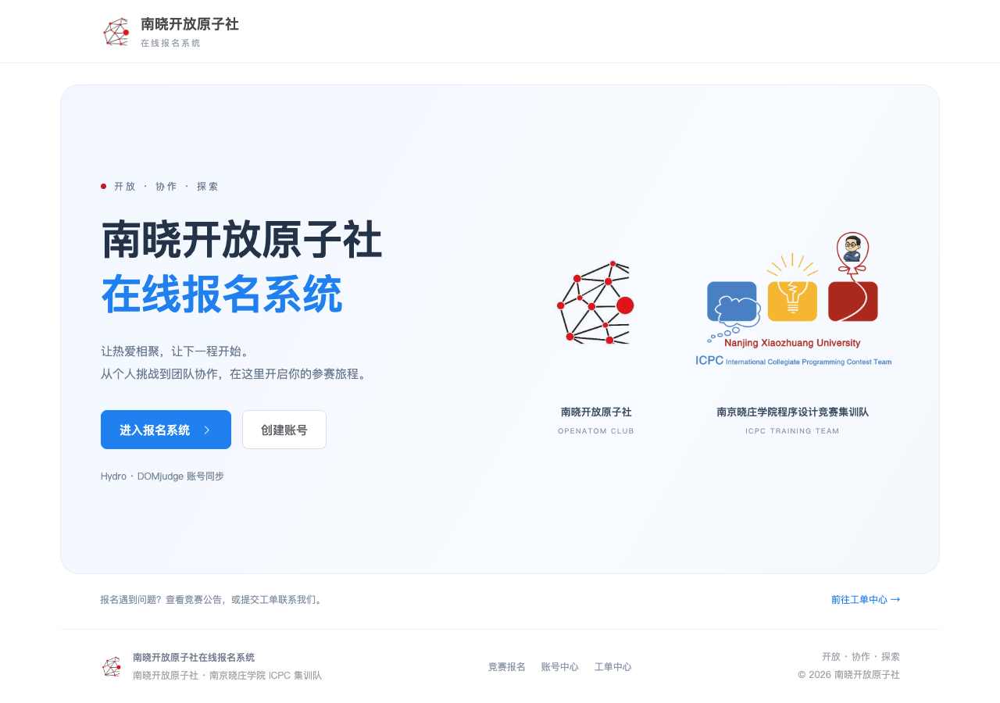
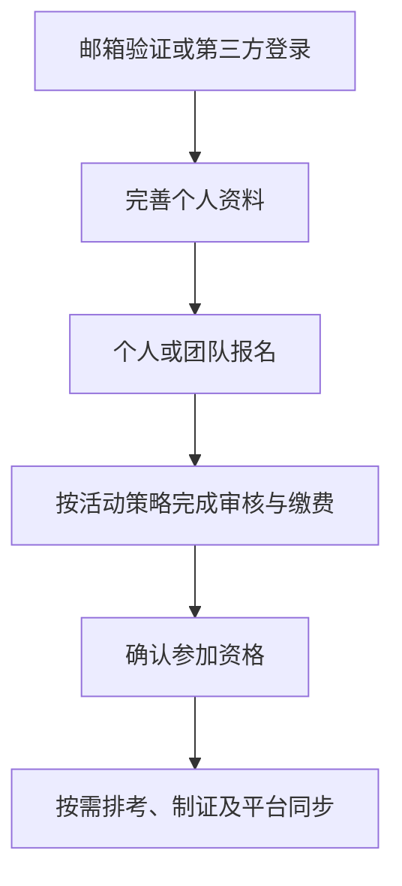
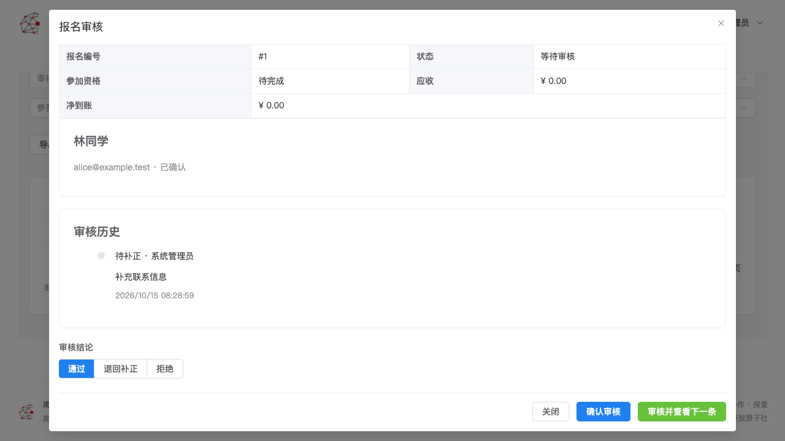
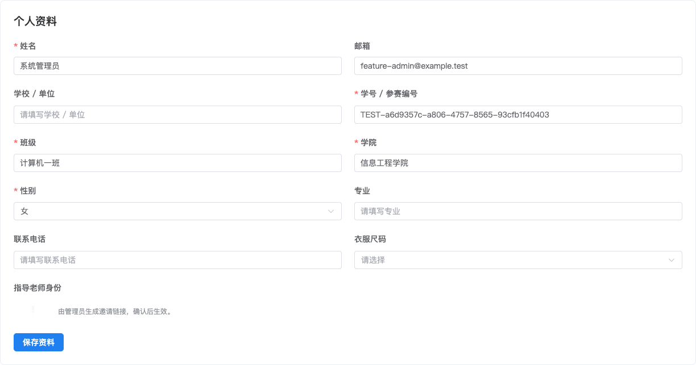

<div align="center">


# NXOPA-RegSYS

### 南晓开放原子社在线报名系统

**从活动发布到参加资格确认，在同一处完成报名、审核、财务与排考。**

[](https://github.com/Albert-Li-Sz/NXOPA-RegSYS/releases/latest) [](https://github.com/Albert-Li-Sz/NXOPA-RegSYS/actions/workflows/release.yml) [](deploy/README.md) [](LICENSE)

**[在线教程](https://albert-li-sz.github.io/NXOPA-RegSYS/) · [下载 v0.6.3](https://github.com/Albert-Li-Sz/NXOPA-RegSYS/releases/tag/v0.6.3) · [部署文档](deploy/README.md)**

[快速开始](#快速开始) · [报名流程](#报名流程) · [功能概览](#功能概览)<br />[界面预览](#界面预览) · [文档导航](#文档导航) · [常见问题](#常见问题)

</div>

```bash
curl -fsSL https://raw.githubusercontent.com/Albert-Li-Sz/NXOPA-RegSYS/main/install.sh -o install.sh
bash install.sh
```

<div align="center">



</div>

NXOPA-RegSYS 是面向校园活动、培训和程序设计竞赛的中文自托管报名平台。组织者按活动配置表单和规则，参与者使用同一账号管理个人或团队报名；老师代填、资料补正、线下财务、准考证及外接评测平台围绕同一份报名协作。

通用活动可以只保留简单报名与审核；竞赛可以按需启用指导老师、费用、多考场和 Hydro / DOMjudge 联动。业务服务与数据部署在自己的服务器上。

> [!IMPORTANT]
> 收费活动采用**线下收款、人工核账、退款记录及发票上传**，未接入在线支付。界面金额单位为元，接口与数据库使用整数分。正式安装通过向导创建管理员，开发演示账号不会自动进入生产环境。

## 快速开始

### 1. 准备环境

| 项目          | 要求                                                      |
| ------------- | --------------------------------------------------------- |
| Docker 服务端 | Linux `amd64` 或 `arm64`；本机试用可使用 Docker Desktop   |
| 宿主机工具    | Docker、Compose **2.24.4+**、Bash、curl、tar、OpenSSL     |
| 公网访问      | 自备域名与 HTTPS 反向代理，将整个站点转发到内部 Caddy     |
| 业务运行时    | 预构建镜像已包含 Node.js、pnpm 和 LaTeX，无需在宿主机安装 |

### 2. 安装并创建管理员

运行上方两条命令，向导会下载并校验正式 Release 安装包，生成私有配置、启动服务并引导创建首次系统管理员。默认安装目录为 `/opt/nxopa-regsys`；自定义目录可运行：

```bash
bash install.sh --dir /srv/nxopa-regsys install
```

本机入口默认为 <http://localhost:8080>，健康检查为：

```bash
curl --fail http://127.0.0.1:8080/api/v1/health
```

默认内部 Caddy 只绑定 `127.0.0.1:8080`。公网部署参照 [Nginx 示例](deploy/nginx.conf.example) 配置 HTTPS，并传递 `Host` 与 `X-Forwarded-Proto`。配置邮件服务、完成验证邮件测试后，再开放邮箱注册。首次管理员使用向导填写的邮箱或用户名登录。

也可下载 [v0.6.3 安装包](https://github.com/Albert-Li-Sz/NXOPA-RegSYS/releases/download/v0.6.3/nxopa-regsys-v0.6.3-install.tar.gz)，比对同一 Release 的 `SHA256SUMS` 后解压，在解压目录运行 `bash install.sh`。完整配置见 [安装说明](deploy/README.md)。

### 3. 更新、备份与维护

在实际安装目录执行；下例使用默认目录：

```bash
cd /opt/nxopa-regsys
bash install.sh status
bash install.sh update
bash install.sh backup /secure/backups
bash install.sh restore /secure/backups/your-backup.ccbak
bash install.sh logs api worker
```

交互更新选择目标版本，先加密备份，再更新安装材料、迁移数据库并等待健康检查。`update --yes` 按已保存的版本执行；需要指定新版时使用 `NXOPA_UPDATE_TAG=v0.6.3 bash install.sh update --yes`。卸载入口为 `bash install.sh uninstall`，默认保留数据。

> [!WARNING]
> 保留原 `ENCRYPTION_KEY`、项目名及升级前的加密备份。旧版本报名流程迁移会永久清理历史取消报名，财务记录独立保留；回退这类迁移需要恢复备份。切换旧根目录 Compose 与新安装入口时，也须保留原项目名、数据库密码和密钥。[升级与恢复说明](docs/DEPLOYMENT.md#加密备份与恢复)

### 镜像与服务

安装使用完整固定版本标签，例如 `ghcr.io/albert-li-sz/nxopa-regsys-api:v0.6.3`，不使用 `latest` 或 `@sha256` 引用。新入口兼容旧包及遗留的自动哈希覆盖，下载包校验与发布镜像核验继续保留。

| 服务        | 安装镜像 / 职责                                                          |
| ----------- | ------------------------------------------------------------------------ |
| API、初始化 | `nxopa-regsys-api:v0.6.3` · 账号、报名、权限及数据库迁移                 |
| Worker      | `nxopa-regsys-worker:v0.6.3` · 邮件、通知、制证、同步及清理任务          |
| Web         | `nxopa-regsys-web:v0.6.3` · 官网与管理界面                               |
| LaTeX       | `nxopa-regsys-latex:v0.6.3` · 隔离编译准考证                             |
| 对象存储    | `nxopa-regsys-minio:v0.6.3` · 内置 MinIO；也可选择第三方 S3 或本地存储   |
| 基础服务    | 官方 `postgres:17.6-alpine`、`redis:7.4.5-alpine`、`caddy:2.10.2-alpine` |

五类业务镜像均位于 `ghcr.io/albert-li-sz/`，支持 `linux/amd64`、`linux/arm64`。PostgreSQL、Redis、Caddy 与应用独立运行，持久数据使用单独卷。

## 报名流程



审核与缴费顺序、老师要求及参加资格按活动策略计算；普通活动可关闭考场、准考证和评测平台。个人报名一人一张准考证，团队成员共用一张；按成员排考时列出各成员座位。

已保存资料默认只读，点击“编辑”后修改并保存。管理员修改资料与参与者提交报名是独立操作；审核使用单独弹窗，已有审核结论通过“修改审核”调整，补正、拒绝及变更结论需要说明原因。

取消报名会永久删除报名及其专属资料，释放报名限制与座位；独立财务记录继续可用，删除本身不自动退款。已同步至外部平台的报名还会生成远端撤权待办，由管理员跟进。

## 功能概览

| 场景         | 已支持能力                                                                                                   |
| ------------ | ------------------------------------------------------------------------------------------------------------ |
| 活动发布     | 通用活动 / 竞赛预设，个人 / 团队、正式 / 非正式报名，自定义成员、队伍、报名和老师字段，报名窗口与名额策略    |
| 账号与协作   | 先验证邮箱再注册，密码、GitHub、飞书登录，学生与教师资料、用户封禁与删除、指导老师关联、链接邀请及可撤销授权 |
| 报名审核     | 草稿、待审核、待补正、已通过、已拒绝状态，审核历史与补正变化，独立审核弹窗，版本冲突检查                     |
| 费用与单据   | 以元配置费用，线下凭证核账、交易参考号去重、退款审批、普通 / 专用发票申请，报名删除后保留财务账户            |
| 考场与准考证 | 多考场容量，个人一人一座、团队一队一座或按成员排考，自动分配预览、手动调整、CSV 导入，LaTeX 模板及 PDF       |
| 日常管理     | 活动总览、统计、按字段展开的 CSV 名单、可调分页、PDF 附件预览、工单、公示排名、邮件模板与顺序备用 SMTP       |
| 平台与接入   | Hydro / DOMjudge 绑定及账号同步，联合注册 API、签名 Webhook、只读 MCP，任务与审计日志                        |

权限按系统、活动及具体管理能力授权。系统管理员维护用户与全局设置，活动管理员仅管理获得授权的活动；报名、审核、财务等接口仍分别检查权限。指导老师在有效关联范围内代填和提交，取消报名由创建者操作，管理员删除需要原因。

## 界面预览

首页上方展示项目品牌；进入系统后，参与者使用“我的报名 / 我的准考证 / 我的附件”，管理员通过各管理中心处理业务。下图来自隔离演示与验收数据。

<details>
<summary><strong>报名审核：核对资料、查看历史，再给出结论</strong></summary>



</details>

<details>
<summary><strong>配置与个人中心：完整页面截图和操作教程</strong></summary>



[查看全部配置截图与操作步骤](https://albert-li-sz.github.io/NXOPA-RegSYS/)

</details>

## 文档导航

| 你要做什么                 | 从这里开始                                                                                                                                                                                                            |
| -------------------------- | --------------------------------------------------------------------------------------------------------------------------------------------------------------------------------------------------------------------- |
| 首次安装、更新、卸载       | [Docker Compose 安装手册](deploy/README.md)                                                                                                                                                                           |
| 按页面配置系统             | [在线图文教程](https://albert-li-sz.github.io/NXOPA-RegSYS/) · [PDF 下载](https://github.com/Albert-Li-Sz/NXOPA-RegSYS/releases/latest/download/configuration-guide.pdf) · [LaTeX 源码](docs/CONFIGURATION_GUIDE.tex) |
| 设置存储、SMTP、用户及权限 | [平台功能说明](docs/PLATFORM_GUIDE.md) · [链接授权与邀请](docs/AUTHORIZATION_INVITATIONS.md)                                                                                                                          |
| 部署代理、备份及恢复       | [部署与运维](docs/DEPLOYMENT.md)                                                                                                                                                                                      |
| 接入 Hydro / DOMjudge      | [外部平台集成](docs/INTEGRATIONS.md) · [Hydro 插件下载](https://albert-li-sz.github.io/NXOPA-RegSYS/#hydro-plugin)                                                                                                    |
| 使用 API、Webhook 或 MCP   | [接口与接入说明](docs/API.md)                                                                                                                                                                                         |
| 配置 LaTeX 和准考证        | [准考证与模板](docs/ADMISSIONS.md)                                                                                                                                                                                    |
| 了解模块和业务规则         | [架构设计](docs/ARCHITECTURE.md) · [业务计划](PROJECT_PLAN.md)                                                                                                                                                        |
| 查看版本、验证及安全范围   | [v0.6.3 更新说明](docs/releases/v0.6.3.md) · [历史验收记录](docs/ACCEPTANCE.md) · [历史增强验收](docs/ENHANCEMENT_ACCEPTANCE.md) · [安全说明](SECURITY.md)                                                            |

## 开发与验证

开发环境需要 Docker、Node.js **24.12.0+** 和项目锁定的 pnpm **11.25.0**：

```bash
git clone https://github.com/Albert-Li-Sz/NXOPA-RegSYS.git
cd NXOPA-RegSYS
pnpm install --frozen-lockfile
pnpm setup
pnpm dev
```

`pnpm dev` 启动独立开发依赖，执行数据库迁移，再启动前端、API 和 Worker。前端位于 <http://localhost:5173>，开发 API 文档为 <http://localhost:3000/api/docs>，Mailpit 为 <http://localhost:58025>；开发与正式安装使用不同的数据卷。

<details>
<summary><strong>创建虚构演示数据</strong></summary>

在开发服务启动后，另开终端执行：

```bash
NODE_ENV=development SEED_DEMO=1 pnpm seed
```

| 用户名                  | 身份           |
| ----------------------- | -------------- |
| `admin`                 | 系统管理员     |
| `manager`               | 示例活动管理员 |
| `alice`、`bob`、`carol` | 参与者         |
| `teacher`               | 指导老师       |

演示密码统一为 `DemoContest2026!`，邮箱为对应用户名的 `@example.test`。演示初始化仅用于隔离开发环境，production 模式拒绝执行。

</details>

### 工程检查

```bash
pnpm typecheck
pnpm build
pnpm test
pnpm test:full
```

`test:full` 使用独立数据库和附件目录运行二十组回归，覆盖账号、活动报名、审核、财务、邮件、附件、安全、并发、API 与浏览器流程。浏览器测试在 macOS 优先使用本机 Chrome，其他环境先运行 `pnpm exec playwright install --with-deps chromium`。

| 专项检查                 | 命令                                                                                 |
| ------------------------ | ------------------------------------------------------------------------------------ |
| 安装、旧包兼容与镜像配置 | `pnpm test:install-cli` · `pnpm test:install-bootstrap` · `pnpm test:install-images` |
| 真实镜像安装与备份恢复   | `INSTALL_TEST_MODE=images IMAGE_TAG=v0.6.3 pnpm test:install`                        |
| 安全与恶意归档           | `pnpm test:security` · `pnpm test:backup-security` · `pnpm audit:runtime`            |
| 活动流程与旧版迁移       | `pnpm test:activity-workflows` · `pnpm test:workflow-upgrade`                        |
| 教程网页与 PDF           | `pnpm docs:build` · `pnpm docs:test` · `bash scripts/build-configuration-guide.sh`   |

发布流程还会在原生 amd64 / arm64 上构建五类业务镜像，并执行安装、升级、HTTPS 代理及备份恢复验收。各版本结果随 Release 附件提供；本地测试报告位于 `.runtime/reports`。验收真实 Hydro / DOMjudge 时，按 [集成文档](docs/INTEGRATIONS.md) 准备环境，再使用 `FULL_REGRESSION_OJ=1 pnpm test:full`。

### 工程结构

```text
apps/web                      Vue 3 / Element Plus 官网、参与者与管理界面
apps/server                   NestJS API、Worker、Prisma 7 及数据库迁移
apps/mcp-adapter               只读 stdio MCP
packages/contracts            表单、计费、资格及联合注册共享契约
packages/connectors           Hydro / DOMjudge 适配器
plugins/hydro-contest-center   Hydro 桥接插件，独立版本发布
deploy                        正式安装 Compose、配置示例与运维说明
infra                         Caddy、隔离 LaTeX Runner 及独立 OJ 实例
scripts                       安装辅助、开发、文档、备份恢复及发布工具
tests                         单元、数据库、浏览器和接入验收
docs                          图文教程、架构、API 及版本说明
```

## 常见问题

<details>
<summary><strong>普通活动也必须配置老师、收费、考场和准考证吗？</strong></summary>

不需要。通用活动预设默认个人、免费、人工审核，不关联老师，隐藏考场、准考证和评测平台；管理员可按需启用。活动类型与个人 / 团队报名形式分别配置。

</details>

<details>
<summary><strong>取消或删除报名后，已经支付的费用会怎样？</strong></summary>

报名永久删除，但收款凭证、账簿、退款和发票保存在独立财务账户中。参与者从“我的报名 → 财务记录”继续处理，管理员从活动管理的“财务记录”进入。删除本身不自动退款，退款仍按财务权限及流程处理。

</details>

<details>
<summary><strong>能把本站密码同步到评测平台吗？</strong></summary>

本站与 Hydro / DOMjudge 使用独立凭据。实例连接、比赛绑定和同步由管理员在外接平台中心配置；本地取消同步与远端撤权分别处理，不将本地删除视为远端账号已撤销。

</details>

<details>
<summary><strong>GitHub Pages 是实际报名服务吗？</strong></summary>

GitHub Pages 仅托管静态教程与下载入口。报名服务需要运行 API、数据库、队列及存储，使用 Docker Compose 部署到自己的服务器。

</details>

<details>
<summary><strong>邮件或镜像拉取失败，应先检查什么？</strong></summary>

邮件先在管理中心检测 SMTP 并向当前管理员发送测试邮件，可配置按顺序使用的备用服务器。镜像拉取先核对完整版本号、失败镜像及代理连通性；`content descriptor ... not found` 表示镜像或镜像代理内容不完整，不能视为安装完成。参见 [安装排障](deploy/README.md)。

</details>

## 参与项目

欢迎通过 [Issues](https://github.com/Albert-Li-Sz/NXOPA-RegSYS/issues) 反馈可复现问题，或提交说明变更与验证结果的 Pull Request。报告问题时提供版本、部署方式、操作步骤和脱敏日志；安全问题请按 [SECURITY.md](SECURITY.md) 的渠道反馈。

代码以 [MIT License](LICENSE) 发布。项目服务于南晓开放原子社与南京晓庄学院程序设计竞赛集训队，使用 Vue、Element Plus、NestJS、Prisma、PostgreSQL、Redis、BullMQ 和 XeLaTeX 等开源组件。Hydro 插件的发布与许可说明见[插件目录](plugins/hydro-contest-center)。README 的布局与阅读顺序参考 [REA](https://github.com/morluto/rea)，内容与界面来自本项目。
