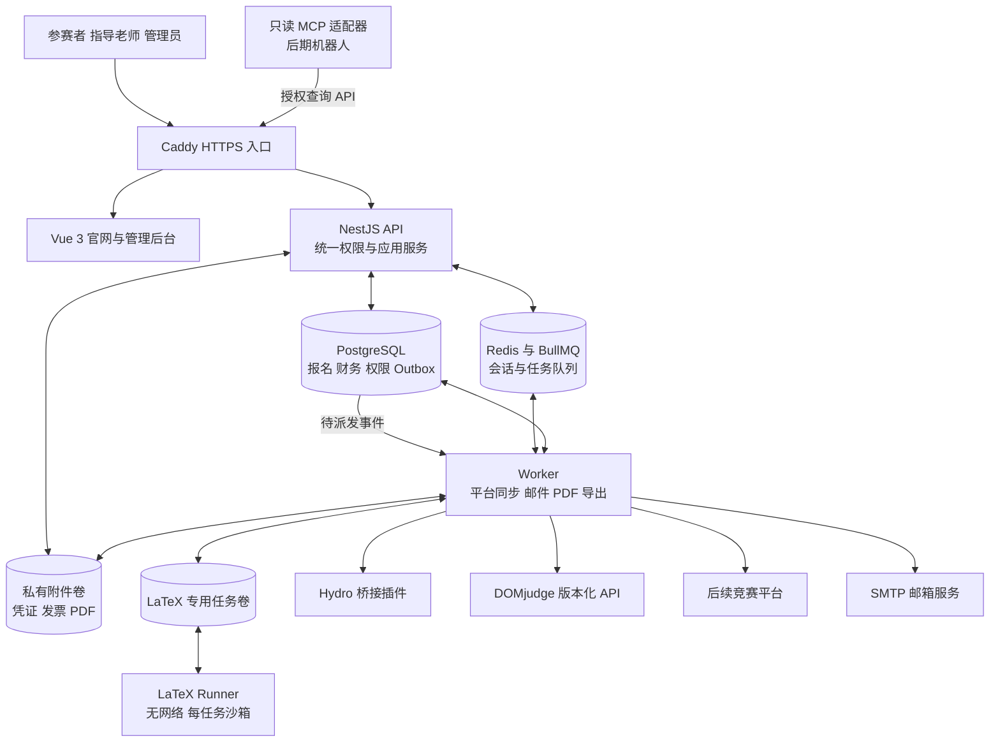
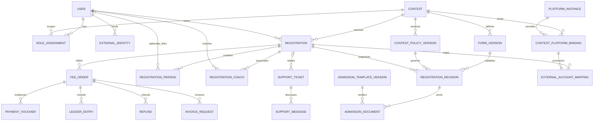
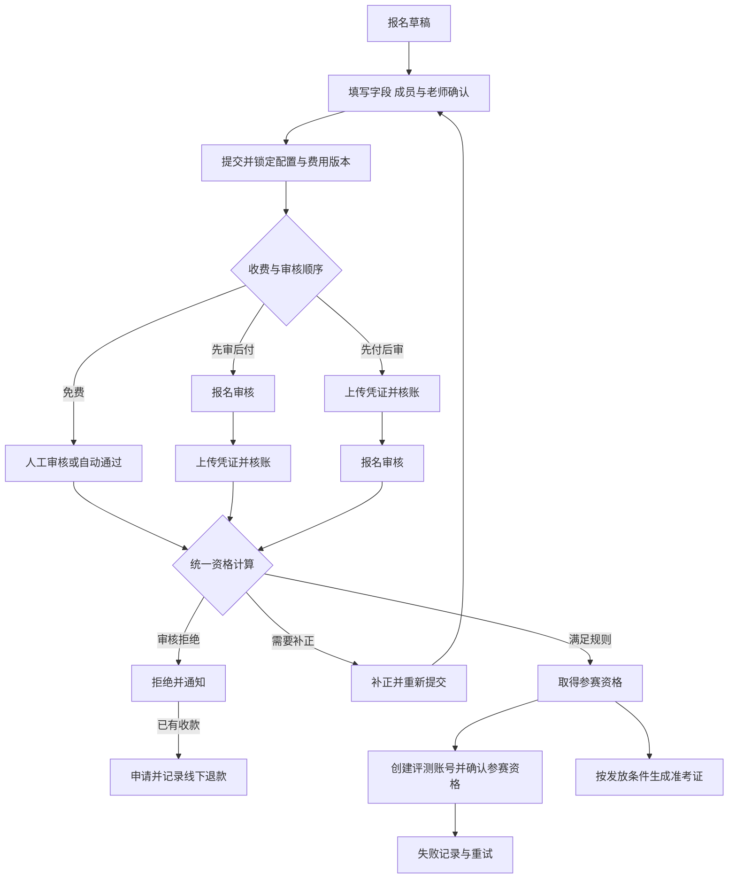

# 南晓开放原子社在线报名系统结构设计

采用 Vue 官网与 NestJS 模块化单体，API 和 Worker 分开运行。PostgreSQL 维护报名、财务与授权的权威数据，远端平台、邮件和 PDF 通过任务执行。完整业务约定见 [项目计划](../PROJECT_PLAN.md)。

## 系统总览

当前结构以下方 Mermaid 为准。[初期结构图](architecture.png)及其 [SVG](architecture.svg)保留为规划留档，其中第三方认证模块已取消。首页 `/` 与竞赛报名入口 `/contests` 分开。



LaTeX Runner 通过专用任务卷交付结果，容器无网络。每次编译使用独立文件沙箱；生产附件卷、数据库凭证和其他任务的文件不进入该沙箱。

## 应用模块

| 模块          | 负责的业务                                       | 主要依赖                       |
| ------------- | ------------------------------------------------ | ------------------------------ |
| identity      | 注册、验证、密码、会话与四类身份                 | SMTP、统一授权                 |
| invitations   | 账号与角色邀请 URL、接收确认、撤销、状态与审计   | identity、contests、coaching   |
| contests      | 竞赛介绍、发布、报名窗口、公告和配置版本         | 全局配置、字段库               |
| forms         | 全局字段、表单配置、版本和服务端校验             | 用户资料预填                   |
| registrations | 个人及团队报名、成员、提交、审核、资格计算       | forms、coaching、finance       |
| coaching      | 指导老师档案、双向关联、代办权限                 | identity、registrations        |
| finance       | 费用快照、凭证、核账、不可覆盖的账簿、退款和开票 | registrations、附件            |
| admissions    | 模板库、预览、生成、版本、发放与下载             | 报名快照、字段库、LaTeX Runner |
| support       | 系统及竞赛工单、回复、附件与处理                 | 用户与竞赛权限                 |
| integrations  | 平台实例、字段映射、连接探测、比赛账号和同步任务 | Connector 契约、报名资格       |
| automation    | 联合注册 API、Webhook、MCP 查询与服务 Token      | 同一套应用服务和权限           |
| shared        | 审计、Outbox、任务、通知、文件与配置             | PostgreSQL、Redis、持久卷      |

API、MCP 与平台接口通过应用服务读取和变更报名。Worker 消费任务并复用业务服务，不建立独立的报名或财务规则。

## 主要数据关系



一个账号可同时成为参赛者、老师或管理员。角色授权通过邀请链接确认，`INVITATION` 保存令牌摘要、接收者、角色、竞赛、有效期和确认时间。确认、角色撤销和老师关联使用 PostgreSQL 事务锁序列化；撤销角色同时使对应未确认邀请失效，已确认链接重放不恢复权限。角色读取仍使用每次请求的当前数据库身份。首次管理员通过初始化命令建立。

代填队员的 `REGISTRATION_PERSON.userId` 可为空。队伍属于报名单；参赛人员和指导老师的当前关系支持编辑，已提交版本保存独立快照。成员邀请与老师关联复用同一 `/invite/:token` 确认页，单次确认在同一事务内消费邀请和建立关系。

## 报名流程



审核拒绝和退回补正可发生在对应审核节点，流程图的统一资格节点只作集中展示。图中财务“核账”要求确认真实到账；上传凭证不能直接使报名合格。平台同步失败保留本站资格，准考证发布仍遵循竞赛规则。

## 拟定项目目录

当前源码按以下目录组织；部署、平台联动、增强功能与验收结果分别见对应文档。

```text
Contest_Center/
├── PROJECT_PLAN.md
├── docs/
│   ├── ARCHITECTURE.md
│   ├── architecture.svg
│   ├── architecture.png
│   ├── api/                         OpenAPI 与联合注册协议
│   └── operations/                  部署 管理 备份与回退说明
├── apps/
│   ├── web/                        Vue 官网与后台
│   │   └── src/
│   │       ├── pages/              public account registration coach admin
│   │       ├── components/         竞赛卡片 动态表单 状态 财务等组件
│   │       ├── api/                生成的 HTTP 客户端
│   │       └── styles/             色彩 布局 与可访问性规范
│   ├── server/                     NestJS API 与 Worker 共用代码库
│   │   ├── src/modules/            业务模块
│   │   ├── src/jobs/               通知 平台同步 PDF 与导出处理
│   │   ├── src/main.ts             API 入口
│   │   ├── src/worker.ts           Worker 入口
│   │   └── prisma/                 数据模型与版本化迁移
│   └── mcp-adapter/                stdio 只读 MCP 适配器
├── packages/
│   ├── contracts/                  类型 字段与协议契约
│   └── connectors/                 Hydro DOMjudge 通用平台与支付接口
├── plugins/
│   └── hydro-contest-center/       Hydro 桥接插件
├── templates/
│   └── admissions/                 中文个人与团队 LaTeX 默认模板
├── infra/
│   ├── compose/                    开发与生产 Docker Compose
│   ├── caddy/                      HTTPS 与同域代理
│   └── latex-runner/               无网络编译镜像与每任务沙箱
├── tests/
│   ├── e2e/                        报名 财务 准考证 工单全流程
│   ├── contracts/                  API 平台与 MCP 协议测试
│   └── integrations/               Hydro 与 DOMjudge 实例验收
└── pnpm-workspace.yaml
```

## 部署与扩展

首版部署一套 Compose。Caddy 为唯一公网入口，数据库和 Redis 位于应用内网；Worker 与 LaTeX Runner 共享独立任务卷，Runner 使用无网络配置。SMTP 与评测平台是外部服务，配置通过受控的管理员界面和部署秘密提供。

后续增加在线支付只新增支付适配器与回调对账，继续使用原有账簿和资格规则；增加竞赛平台只新增 Connector 或采用联合注册协议；机器人读取同一套查询 API。需要增加服务器时，先扩展无状态 API 与 Worker，并将文件存储切换为已预留的 S3 后端。
